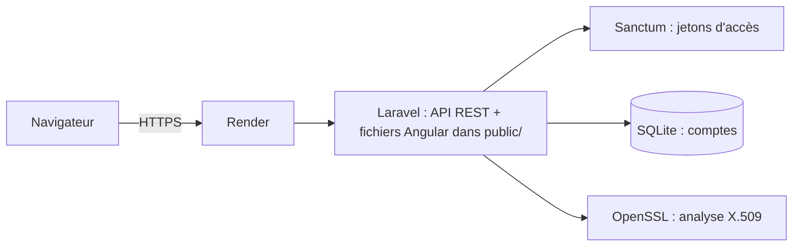

# Laboratoire web de validation de certificats numériques X.509

Projet de protocoles de sécurité réseau, Master 1 Informatique, Université de Kinshasa. Groupe 09, thème « Cryptographie appliquée ».

- **Site déployé :** À COMPLÉTER (URL Render en `https://`)
- **Dépôt GitHub :** À COMPLÉTER
- **Code source Angular (frontend) :** dossier `frontend/` de ce dépôt

## 1. Membres du groupe

| N° | Nom |
|----|-----|
| 1 | BWAZU IMONA Didier|
| 2 | MAKOKO MOPELEMA Sylvie |
| 3 | ESIMBA NGOWA Salem |
| 4 | LOHALO OMASUKU Jules |
## 2. Objectifs

Concevoir, développer et déployer une application web qui montre concrètement l'analyse d'un certificat X.509. L'utilisateur crée un compte, se connecte, colle un certificat au format PEM (ou insère un exemple) et obtient :

- le sujet et l'émetteur du certificat ;
- la période de validité et son état (valide, expiré, pas encore valide) ;
- le type et la taille de la clé publique, l'algorithme de signature, le numéro de série ;
- les empreintes SHA-256 et SHA-1 ;
- le statut de révocation CRL et OCSP (simulé) ;
- un diagnostic TLS qui signale les problèmes détectés (certificat expiré, auto-signé, signature faible, clé trop courte).

Si le texte collé n'est pas un certificat valide, l'application affiche une erreur claire et n'invente aucun résultat.

Toutes les données sont fictives : aucun certificat réel, aucune donnée personnelle réelle.

## 3. Architecture



- **Frontend :** Angular. Une seule application à états : accueil, connexion, inscription, laboratoire. Un intercepteur HTTP ajoute le jeton d'accès dans l'en-tête `Authorization: Bearer ...`.
- **Backend :** Laravel. Il expose l'API sous `/api` et sert aussi le build Angular depuis le dossier `public/`. Le site et l'API ont donc la même origine, ce qui évite les problèmes de CORS.
- **Base de données :** SQLite, utilisée uniquement pour les comptes et les jetons.
- **Analyse des certificats :** fonctions OpenSSL de PHP (`openssl_x509_parse`, `openssl_x509_fingerprint`, `openssl_pkey_get_details`).

### Structure du dépôt

| Élément | Rôle |
|---------|------|
| `app/Http/Controllers/AuthController.php` | Inscription, connexion, déconnexion |
| `app/Http/Controllers/Api/CertificatController.php` | Analyse des certificats |
| `routes/api.php` | Routes de l'API |
| `routes/web.php` | Route `/` qui sert l'interface Angular |
| `database/seeders/DemoUserSeeder.php` | Compte de démonstration |
| `public/` | Build Angular, `index.php`, `.htaccess` |
| `frontend/` | Code source Angular |
| `Dockerfile` | Image utilisée par Render |

### Routes de l'API

| Méthode | Route | Accès | Rôle |
|---------|-------|-------|------|
| POST | `/api/register` | public, 5 requêtes/minute | Créer un compte |
| POST | `/api/login` | public, 10 requêtes/minute | Se connecter |
| GET | `/api/me` | connecté | Récupérer l'utilisateur courant |
| POST | `/api/logout` | connecté | Se déconnecter (supprime le jeton) |
| POST | `/api/certificates/parse` | connecté, 30 requêtes/minute | Analyser un certificat PEM |

## 4. Protocoles et mécanismes de sécurité

| Mécanisme | Où | Rôle |
|-----------|----|------|
| HTTPS/TLS | Render | Chiffre les échanges entre le navigateur et le serveur |
| Authentification par jetons (Laravel Sanctum) | API | Seuls les utilisateurs connectés peuvent analyser un certificat |
| Hachage des mots de passe (bcrypt) | Modèle `User` | Les mots de passe ne sont jamais stockés en clair |
| Validation des entrées | Laravel et Angular | Format de l'e-mail, mot de passe d'au moins 8 caractères avec lettres et chiffres, taille maximale du certificat |
| Limitation de débit (`throttle`) | Routes API | Ralentit les tentatives répétées (force brute) |
| Empreintes SHA-256 et SHA-1 | Analyse X.509 | Identifier un certificat de façon unique |
| Messages d'erreur génériques | Connexion | « Adresse e-mail ou mot de passe incorrect », sans révéler si le compte existe |
| Secrets dans des variables d'environnement | Render | Aucune clé ni aucun mot de passe dans le code source |

## 5. Installation en local

Prérequis : Git, PHP 8.3 ou plus avec Composer, Node.js 20 ou plus, Angular CLI.

```bash
# 1. Récupérer le code
git clone git@github.com:TON_COMPTE/TON_DEPOT.git
cd TON_DEPOT

# 2. Backend
composer install
cp .env.example .env
php artisan key:generate
touch database/database.sqlite
php artisan migrate
php artisan db:seed --class=DemoUserSeeder
php artisan serve        # http://127.0.0.1:8000
```

Le site est alors complet sur `http://127.0.0.1:8000`, avec le build Angular déjà présent dans `public/`.

Pour modifier le frontend, dans un autre terminal :

```bash
cd frontend
npm install
ng serve                 # http://localhost:4200
```

`ng serve` redirige les appels `/api` vers Laravel grâce au fichier `frontend/proxy.conf.json` :

```json
{
  "/api": {
    "target": "http://127.0.0.1:8000",
    "secure": false,
    "changeOrigin": true
  }
}
```

## 6. Build du frontend

Laravel sert le frontend sous forme de fichiers statiques. Il faut donc un build Angular en mode statique, sans rendu côté serveur.

**Étape 1. Configurer Angular en mode statique.** Dans `angular.json`, bloc `build` → `options`, les clés `server`, `outputMode` et `ssr` sont supprimées.

**Étape 2. Générer le build.**

```bash
cd frontend
rm -rf dist .angular
ng build
```

Les fichiers sont créés dans `dist/frontend-certificat/browser/` : `index.html`, `main-*.js`, `polyfills-*.js`, `styles-*.css`, `favicon.ico`. Il ne doit pas y avoir de dossier `server`.

**Étape 3. Copier le build dans Laravel.** Les noms des fichiers changent à chaque build, donc les anciens sont supprimés d'abord. Les fichiers `index.php` et `.htaccess` doivent rester en place.

```bash
cd ../public
rm -rf server index.csr.html index.html prerendered-routes.json 3rdpartylicenses.txt *.js *.css
cp -r ../frontend/dist/frontend-certificat/browser/* .
```

**Étape 4. Servir l'interface.** La route `/` de Laravel renvoie le fichier `public/index.html` (fichier `routes/web.php`) :

```php
Route::get('/', function () {
    return response()->file(public_path('index.html'));
});
```

**Étape 5. Vérifier en local.** `php artisan serve`, puis ouvrir `http://127.0.0.1:8000`. L'application complète doit s'afficher et fonctionner, comme sur Render.

## 7. Versionnement avec Git

**Configuration unique de la machine :**

```bash
git config --global user.name "Nom Prénom"
git config --global user.email "adresse-du-compte-github"
ssh-keygen -t ed25519 -C "adresse-du-compte-github"
cat ~/.ssh/id_ed25519.pub        # à ajouter dans GitHub : Settings → SSH and GPG keys
ssh -T git@github.com            # doit afficher « successfully authenticated »
```

**À chaque modification livrée :**

```bash
git add -A
git status
git commit -m "Message décrivant la modification"
git push
```

Avant le `commit`, `git status` est vérifié : les fichiers `.env` et `database/database.sqlite` ne doivent pas apparaître, car ils sont exclus par `.gitignore`. Les secrets restent donc hors de GitHub. Le build Angular copié dans `public/` est, lui, commité, car c'est ce que Render sert.

## 8. Déploiement sur Render

Le site est hébergé sur Render, qui active HTTPS automatiquement. Le service utilise le `Dockerfile` du dépôt, et Render le reconstruit à chaque `git push` sur la branche `main`.

**Étape 1. Variables d'environnement.** Dans le tableau de bord Render : service → **Environment**.

| Variable | Valeur |
|----------|--------|
| `APP_ENV` | `production` |
| `APP_DEBUG` | `false` |
| `APP_KEY` | générée avec `php artisan key:generate --show` |
| `APP_URL` | URL du site en `https://` |
| `DB_CONNECTION` | `sqlite` |
| `LOG_CHANNEL` | `stderr` |

`APP_DEBUG=false` empêche l'affichage de détails internes en cas d'erreur.

**Étape 2. Démarrage du service.** La dernière ligne du `Dockerfile` crée la base SQLite, applique les migrations et crée le compte de démonstration à chaque démarrage, puis lance le serveur sur le port fourni par Render :

```bash
touch database/database.sqlite
php artisan migrate --force
php artisan db:seed --class=DemoUserSeeder --force
php artisan serve --host=0.0.0.0 --port=${PORT:-10000}
```

Sur l'offre gratuite de Render, le fichier SQLite est effacé à chaque redéploiement ou redémarrage. Les comptes créés par les visiteurs disparaissent donc, et le compte de démonstration est recréé automatiquement.

**Étape 3. Publier.**

```bash
git push
```

Render lance un nouveau déploiement. Dans les **Logs**, le déploiement est réussi quand le serveur démarre sans erreur et que le statut passe à **Live**. Sans déploiement automatique : **Manual Deploy → Deploy latest commit**.

**Étape 4. Vérifier en navigation privée.**

- le site s'ouvre en `https://` ;
- la connexion avec le compte de démonstration fonctionne ;
- l'inscription, l'analyse d'un certificat et la déconnexion fonctionnent.

Le premier chargement peut prendre environ une minute si le service gratuit était en veille.

### Identifiants de démonstration

| E-mail | Mot de passe |
|--------|--------------|
| `demo@unikin.test` | `Demo2026pass` |

Ce compte est fictif et n'existe que pour la démonstration.

### Certificat de démonstration

Le bouton « Insérer un exemple » charge un certificat fictif pour `demo.unikin.test`, signé par une autorité de test (« UNIKIN Demo Root CA ») et contenant des adresses CRL et OCSP. Il a été créé avec OpenSSL :

```bash
openssl req -x509 -newkey rsa:2048 -nodes -keyout ca.key -out ca.pem -days 1825 \
  -subj "/CN=UNIKIN Demo Root CA/O=UNIKIN/C=CD"
openssl req -newkey rsa:2048 -nodes -keyout site.key -out site.csr \
  -subj "/CN=demo.unikin.test/O=UNIKIN Groupe 09/C=CD"
openssl x509 -req -in site.csr -CA ca.pem -CAkey ca.key -CAcreateserial \
  -out site.pem -days 365 -sha256 -extfile ext.cnf
```

Le fichier `ext.cnf` déclare les extensions (`basicConstraints`, `keyUsage`, `subjectAltName`, `crlDistributionPoints`, `authorityInfoAccess`). Les clés privées ne sont pas publiées dans le dépôt.

## 9. Tests

### Tests de l'API (avec `curl`)

```bash
# Inscription : attendu HTTP 201 avec un jeton
curl -i -X POST http://127.0.0.1:8000/api/register \
  -H "Accept: application/json" -H "Content-Type: application/json" \
  -d '{"name":"Test","email":"test@example.com","password":"Abcdef12","password_confirmation":"Abcdef12"}'

# Analyse sans jeton : attendu HTTP 401
curl -i -X POST http://127.0.0.1:8000/api/certificates/parse \
  -H "Accept: application/json" -H "Content-Type: application/json" \
  -d '{"certificate":"test"}'
```

### Scénarios de test dans l'application

| Scénario | Résultat attendu |
|----------|------------------|
| Connexion avec des champs vides | Boîte de dialogue d'erreur, champs encadrés en rouge |
| Inscription avec un e-mail déjà utilisé | Message « Cette adresse e-mail est déjà utilisée » |
| Connexion avec un mauvais mot de passe | Message « Adresse e-mail ou mot de passe incorrect » |
| Plus de 10 tentatives de connexion en une minute | Message « Trop de tentatives » (HTTP 429) |
| Analyse d'un texte qui n'est pas un certificat | Message « Certificat illisible » (HTTP 422) |
| Analyse du certificat de démonstration | Bandeau vert, « Aucun problème détecté » |
| Analyse d'un certificat auto-signé | Bandeau orange, diagnostic « Auto-signé » |
| Analyse d'un certificat expiré | Bandeau rouge, « Expiré depuis X jour(s) » |
| Rechargement de la page après connexion | L'utilisateur reste connecté |
| Déconnexion | Retour à l'accueil, jeton supprimé |

## 10. Menaces traitées et limites

### Menaces traitées

| Menace | Mesure |
|--------|--------|
| Écoute des échanges | HTTPS/TLS sur Render |
| Vol de la base de mots de passe | Hachage bcrypt |
| Force brute sur la connexion | Limitation de débit, mot de passe robuste exigé |
| Découverte des comptes existants | Message d'erreur identique pour un e-mail inconnu ou un mauvais mot de passe |
| Accès non autorisé à l'analyse | Route protégée par jeton (`auth:sanctum`) |
| Entrées malformées ou trop volumineuses | Validation côté serveur (format, taille maximale de 20 000 caractères) |
| Fuite d'informations par les erreurs | `APP_DEBUG=false`, messages d'erreur contrôlés |
| Fuite de secrets | Variables d'environnement, `.env` exclu de Git |

### Limites

- **CRL et OCSP sont simulés.** L'application lit les extensions présentes dans le certificat, mais n'interroge aucun serveur de révocation réel. Un numéro de série peut être déclaré « révoqué » dans une liste de démonstration.
- **La chaîne de confiance n'est pas vérifiée** par rapport à un magasin d'autorités de confiance. Le diagnostic signale seulement qu'un certificat est auto-signé. Un navigateur refuserait donc le certificat de démonstration, car son autorité n'est pas connue.
- **Les comptes ne sont pas conservés** sur l'offre gratuite de Render (SQLite non persistant).
- **Le jeton d'accès est gardé dans `sessionStorage`.** Il est effacé à la fermeture de l'onglet, mais il serait lisible en cas de faille XSS.
- **Pas d'authentification à deux facteurs**, et pas de durée de vie limitée des jetons (à configurer dans `config/sanctum.php`).

## 11. Captures d'écran


## 12. Dépendances externes

- [Laravel](https://laravel.com) : framework backend
- [Laravel Sanctum](https://laravel.com/docs/sanctum) : authentification par jetons
- [Angular](https://angular.dev) : framework frontend
- [RxJS](https://rxjs.dev) : programmation réactive (appels HTTP)
- [Tailwind CSS](https://tailwindcss.com) : mise en forme (À VÉRIFIER : confirmer que le projet l'utilise)
- [OpenSSL](https://www.openssl.org) (extension PHP) : analyse des certificats X.509
- [Render](https://render.com) : hébergement

Ressources consultées sur les certificats X.509 : À COMPLÉTER (par exemple RFC 5280, documentation PHP sur OpenSSL).